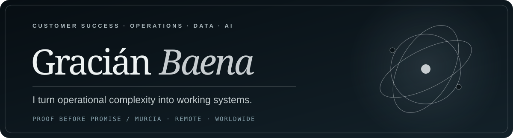
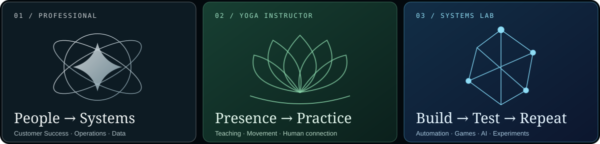

<div align="center">

<a href="https://gracianb.github.io/GracianB/">
  
</a>

# Gracián Baena

### Customer Success · Operations · Data · Automation

**I connect real-world operations with thoughtful systems people can actually use.**

16+ years across customer-facing work, teams, and operations—now bringing that experience together with **Zendesk, analytics, Python, JavaScript, and automation**.

**Murcia, Spain · Open to remote and international collaboration · Spanish / English / Italian**

[**Explore my portfolio**](https://gracianb.github.io/GracianB/) &nbsp;·&nbsp;
[**Professional work**](https://gracianb.github.io/professional-deck/) &nbsp;·&nbsp;
[**English résumé**](./Gracian_Baena_CV_2026_EN.pdf) &nbsp;·&nbsp;
[**Get in touch**](https://www.linkedin.com/in/gracianbaena/)

</div>

---

## Start with the evidence

A few clear entry points, each with its own context and honest project status.

| Focus | Explore | What you will find |
| --- | --- | --- |
| **Customer Success & Operations** | [Bodytone Support OS case study ↗](https://gracianb.github.io/professional-deck/proyecto-bodytone.html) · [Public Help Center ↗](https://bodytonehelp.zendesk.com/hc/es) | A documented customer-operations ecosystem built around support workflows, knowledge, automation, and reporting. |
| **Revenue Operations & decision systems** | [Professional Deck ↗](https://gracianb.github.io/professional-deck/) | Role-focused work and systems thinking. RevOps Studio is in development; check its linked project for current access and status. |
| **Software, automation & AI** | [Systems Lab ↗](https://gracianb.github.io/systems-lab/) · [Project OHANA ↗](https://gracianb.github.io/project-ohana/) · [OHANA source ↗](https://github.com/GracianB/project-ohana) | Experiments and working projects in software, applied AI, game systems, and creative technology. |

> **A note on proof:** Public cases, prototypes, and private/local work are identified separately. A project page or demo is not, by itself, a claim of production deployment or measured business impact.

## Three worlds, one point of view

This repository is the **personal hub** connecting three distinct portfolios—not a replacement for them.

| World | Explore |
| --- | --- |
| **Professional** — customer experience, operations, data, and automation | [Professional Deck ↗](https://gracianb.github.io/professional-deck/) |
| **Yoga** — teaching, mindful movement, and practice | [Yoga Instructor ↗](https://gracianb.github.io/yoga-instructor/) |
| **Systems Lab** — software, AI, experiments, and interactive work | [Systems Lab ↗](https://gracianb.github.io/systems-lab/) |

[](https://gracianb.github.io/GracianB/#universes)

The [live hub](https://gracianb.github.io/GracianB/) is bilingual (English and Spanish), responsive, and published with GitHub Pages. It includes a language and theme switch, a keyboard-accessible quick navigator, project evidence, and a city atlas. Explore it directly for the full experience.

## Résumés and application documents

The PDFs in this repository are the canonical public application documents. The [application desk ↗](https://gracianb.github.io/GracianB/apply.html) helps select a track and language.

| Track | Résumé · English | Résumé · Spanish | Cover letter · English | Letter · Spanish |
| --- | --- | --- | --- | --- |
| **Professional** | [PDF](./Gracian_Baena_CV_2026_EN.pdf) | [PDF](./Gracian_Baena_CV_2026_ES.pdf) | [PDF](./Gracian_Baena_Cover_Letter_EN.pdf) | [PDF](./Gracian_Baena_Carta_Presentacion_ES.pdf) |
| **Yoga** | [PDF](./Gracian_Baena_CV_Yoga_EN.pdf) | [PDF](./Gracian_Baena_CV_Yoga_ES.pdf) | [PDF](./Gracian_Baena_Cover_Letter_Yoga_EN.pdf) | [PDF](./Gracian_Baena_Carta_Yoga_ES.pdf) |
| **Cabin crew** | [PDF](./Gracian_Baena_CV_TCP_EN.pdf) | [PDF](./Gracian_Baena_CV_TCP_ES.pdf) | [PDF](./Gracian_Baena_Cover_Letter_TCP_EN.pdf) | [PDF](./Gracian_Baena_Carta_TCP_ES.pdf) |

Please use these links rather than copies hosted elsewhere; review the documents themselves for the details relevant to a specific application.

## About this repository

This is the source for my public profile hub and its companion application pages. It is a static site: HTML, CSS, and JavaScript, with no application backend. GitHub Pages serves the site from the repository root.

| Path | Purpose |
| --- | --- |
| `index.html`, `main.js`, `i18n.js` | Main hub, interactions, and English/Spanish content |
| `styles.css`, `*-v*.css` | Site styling and responsive visual systems |
| `apply.html`, `apply.js`, `apply.css` | Application desk and role-specific summaries |
| `cabin-*.html`, `cabin-*.css`, `cabin-*.js` | Cabin-crew portfolio and application pages |
| `docs/` | Portfolio artwork and visual assets |
| `scripts/` | Static checks and browser-test tooling |
| `.github/workflows/` | Continuous integration and publishing workflows |
| `Gracian_Baena_*.pdf` | Canonical public application documents |

### Run locally

From the repository root, start a static web server:

```bash
python -m http.server 8000
```

Then open [http://localhost:8000](http://localhost:8000). No build step or backend is required for the static pages.

## Contact

For professional conversations, collaboration, or questions about a public project:

[**LinkedIn**](https://www.linkedin.com/in/gracianbaena/) &nbsp;·&nbsp;
[**Book a conversation**](https://calendar.app.google/n99psBFktwYyoAWi9) &nbsp;·&nbsp;
[**Email**](mailto:gracianbaenagonzalez@gmail.com)

---

<sub>Built with care in Murcia, Spain. The linked portfolios have their own repositories, release cycles, and project-specific status.</sub>
