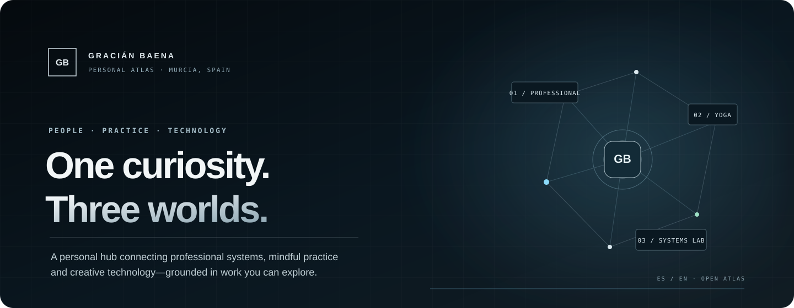

<div align="center">

<a href="https://gracianb.github.io/GracianB/">
  
</a>

# Gracián Baena

### Customer Success · Operations · Data · Automation

**I turn real operational friction into systems people can understand, trust and use.**

16+ years across customer-facing work, teams and operations—now connecting that experience with **Zendesk, analytics, Python, JavaScript and thoughtful automation**.

**Murcia, Spain** &nbsp;·&nbsp; **Spanish · English · Italian** &nbsp;·&nbsp; **Open to remote and international collaboration**

[**Explore the hub ↗**](https://gracianb.github.io/GracianB/) &nbsp;·&nbsp;
[**Professional evidence ↗**](https://gracianb.github.io/professional-deck/) &nbsp;·&nbsp;
[**English résumé ↗**](./Gracian_Baena_CV_2026_EN.pdf) &nbsp;·&nbsp;
[**Contact ↗**](https://www.linkedin.com/in/gracianbaena/)

</div>

---

## A connected body of work

One personal hub. Three distinct worlds. Each has a clear purpose and its own portfolio.

| 01 · PROFESSIONAL | 02 · PRACTICE | 03 · EXPERIMENTATION |
| --- | --- | --- |
| **People, operations and evidence.** Customer Success, Customer Operations, data, automation and real-world cases. | **Movement, attention and teaching.** Yoga practice and instruction, presented on its own terms. | **Ideas made tangible.** Software, applied AI, interactive projects and creative technology. |
| [Explore Professional Deck ↗](https://gracianb.github.io/professional-deck/) | [Explore Yoga Instructor ↗](https://gracianb.github.io/yoga-instructor/) | [Explore Systems Lab ↗](https://gracianb.github.io/systems-lab/) |

[](https://gracianb.github.io/GracianB/#universes)

This repository is the **personal front door**, not a second CV and not a replacement for the specialist portfolios. The [live hub](https://gracianb.github.io/GracianB/) brings the worlds together with English/Spanish content, light/dark themes, responsive layouts and keyboard-accessible navigation.

## Begin with proof

### Customer Success & Customer Operations

[**Bodytone Support OS — case study ↗**](https://gracianb.github.io/professional-deck/proyecto-bodytone.html) · [**Public Help Center ↗**](https://bodytonehelp.zendesk.com/hc/es)

A documented support-operations case involving Zendesk, knowledge, routing, automation, reporting and team adoption. The public case and Help Center are examples to inspect; they do not disclose private customer data or claim unverified business outcomes.

### Revenue Operations & decision systems

[**RevOps Studio — public sample-data demo ↗**](https://gracianb.github.io/revops-studio/demo.html) · [**Professional Deck ↗**](https://gracianb.github.io/professional-deck/)

Explore decision workflows, scoring, traceability and operational thinking. The demo uses sample data; it is not a production customer system.

### Software & creative technology

[**Project OHANA ↗**](https://gracianb.github.io/project-ohana/) · [**Source ↗**](https://github.com/GracianB/project-ohana) · [**VØRTICE ↗**](https://vortex-gilt-xi.vercel.app/) · [**Systems Lab ↗**](https://gracianb.github.io/systems-lab/)

Interactive work spanning browser systems, simulation, WebGL and applied AI. Public showcases, demos, private applications and local experiments are distinguished by their actual access and deployment status. **Aigoritmo is a local/private application; its Systems Lab page is a showcase, not a public chat service.**

> **Evidence over hype:** a prototype is not automatically a production system; a demo is not automatically customer data; and a published page is not a measured business result. Project pages describe their own scope and status.

## How I approach the work

<div align="center">

**LISTEN → UNDERSTAND THE OPERATION → READ THE SIGNAL → DESIGN THE SYSTEM → SUPPORT ADOPTION**

</div>

I connect the human context with the operational detail: where a customer gets stuck, how a team handles the work, what the data can and cannot tell us, and which change would be useful in practice. The tools matter—but the goal is a system that fits the people using it.

## Résumés & applications

The PDFs in this repository are the **canonical public application documents**. Use the [application desk ↗](https://gracianb.github.io/GracianB/apply.html) to select a track, language and supporting evidence.

| Track | Résumé · EN | Résumé · ES | Cover letter · EN | Letter · ES |
| --- | --- | --- | --- | --- |
| **Professional** | [PDF](./Gracian_Baena_CV_2026_EN.pdf) | [PDF](./Gracian_Baena_CV_2026_ES.pdf) | [PDF](./Gracian_Baena_Cover_Letter_EN.pdf) | [PDF](./Gracian_Baena_Carta_Presentacion_ES.pdf) |
| **Yoga** | [PDF](./Gracian_Baena_CV_Yoga_EN.pdf) | [PDF](./Gracian_Baena_CV_Yoga_ES.pdf) | [PDF](./Gracian_Baena_Cover_Letter_Yoga_EN.pdf) | [PDF](./Gracian_Baena_Carta_Yoga_ES.pdf) |
| **Cabin crew** | [PDF](./Gracian_Baena_CV_TCP_EN.pdf) | [PDF](./Gracian_Baena_CV_TCP_ES.pdf) | [PDF](./Gracian_Baena_Cover_Letter_TCP_EN.pdf) | [PDF](./Gracian_Baena_Carta_TCP_ES.pdf) |

## The live hub

The home page is a small, fast, static site—no application backend required. Its interactive constellation connects the three portfolios; the city atlas presents six personal chapters as narrative context, **not** a travel itinerary or inferred employment timeline. Project evidence and the document library are available alongside the main navigation.

[**Visit gracianb.github.io/GracianB ↗**](https://gracianb.github.io/GracianB/)

### Run locally

From the repository root:

```bash
python -m http.server 8000
```

Open [http://localhost:8000](http://localhost:8000). Static pages need no build step or backend.

| Path | Purpose |
| --- | --- |
| `index.html`, `main.js`, `i18n.js` | Main hub, interactions and ES/EN content |
| `styles.css`, `*-v*.css` | Visual system and responsive presentation |
| `apply.html`, `apply.js`, `apply.css` | Application desk and role-specific summaries |
| `cabin-*.html`, `cabin-*.css`, `cabin-*.js` | Cabin-crew portfolio and application pages |
| `docs/` | Portfolio artwork and visual assets |
| `scripts/`, `.github/workflows/` | Static/browser checks, CI and publishing |
| `Gracian_Baena_*.pdf` | Canonical public application documents |

## Contact

For professional conversations, collaboration or questions about a public project:

[**LinkedIn**](https://www.linkedin.com/in/gracianbaena/) &nbsp;·&nbsp;
[**Book a conversation**](https://calendar.app.google/n99psBFktwYyoAWi9) &nbsp;·&nbsp;
[**Email**](mailto:gracianbaenagonzalez@gmail.com)

---

<div align="center">

**One curiosity. Three worlds. Work you can explore.**

[Personal hub](https://gracianb.github.io/GracianB/) · [Professional Deck](https://gracianb.github.io/professional-deck/) · [Yoga Instructor](https://gracianb.github.io/yoga-instructor/) · [Systems Lab](https://gracianb.github.io/systems-lab/)

<sub>Built with care in Murcia, Spain. Each linked portfolio has its own scope, repository and release cycle.</sub>

</div>
