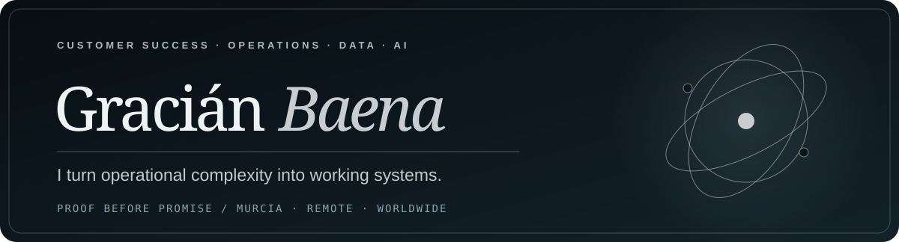
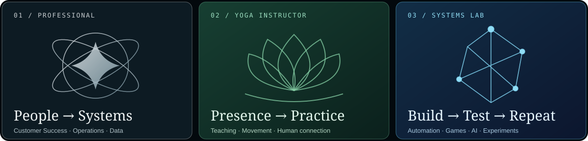

# GracianB · V1 Official
**Una misma curiosidad. Tres universos.**

[Explorar el atlas](https://gracianb.github.io/GracianB/) · [Professional](https://gracianb.github.io/professional-deck/) · [Yoga](https://gracianb.github.io/yoga-instructor/) · [Systems Lab](https://gracianb.github.io/systems-lab/)

## Sobre el proyecto
Sitio personal estático, bilingüe (ES/EN), que organiza trayectoria profesional, yoga y experimentación técnica sin confundirlos con un único CV. Diseñado para funcionar en GitHub Pages, sin backend ni credenciales en el navegador.

## Explorar
| Universo | Contenido |
| --- | --- |
| [Professional Deck](https://gracianb.github.io/professional-deck/) | Customer Success, operaciones, sistemas, datos y resultados. |
| [Yoga Instructor](https://gracianb.github.io/yoga-instructor/) | Práctica, docencia, movimiento y presencia. |
| [Systems Lab](https://gracianb.github.io/systems-lab/) | Software, IA, juegos y prototipos con sus propios repositorios. |

**Acceso rápido:** Ctrl+K (o Cmd+K), búsqueda por texto, filtros, flechas, Enter y Escape. Los tres nodos de la portada llevan a los universos.

## Estructura
- `index.html`, `styles.css`, `portal-v11.css`, `hub-finish.css`, `deck-dark.css`: portada y estilos.
- `main.js`, `i18n.js`: navegación, atlas interactivo, accesibilidad, preferencias y traducciones.
- `apply.html`, `apply.js`, `apply.css`: acceso a documentos de candidatura.
- `cabin-*.html/css/js`: contenido específico de aviación.
- `Gracian_Baena_*.pdf`: doce documentos públicos en español e inglés (CV y cartas).
- `docs/`: recursos SVG y documentación de presentación.
- `scripts/`: contratos, regresión visual, mediciones y verificaciones públicas.
- `.github/workflows/`: calidad, publicación PDF, smoke y salud de enlaces.

## Desarrollo y validación
No hay instalación de una aplicación ni build obligatorio para publicar el HTML. Para reproducir controles locales se requiere Node.js y las dependencias de Playwright usadas por las pruebas del repositorio.

Ejecutar un servidor HTTP local desde la raíz, por ejemplo `python -m http.server 8000`, y abrir `http://localhost:8000/GracianB/` solo si se sirve bajo esa ruta; para una raíz local ordinaria usar `http://localhost:8000/`.

La V1 se valida con contratos estáticos, pruebas en Chromium (escritorio/móvil, ES/EN, claro/oscuro), comprobaciones de enlaces/PDF, presupuesto de rendimiento y despliegue de GitHub Pages. Un check verde no sustituye la revisión visual de la versión publicada.

## Documentos
Los doce PDF están versionados públicamente porque se ofrecen en el sitio de candidaturas. **No añadir** identificaciones, teléfonos personales, direcciones privadas, secretos, tokens ni documentos internos por accidente. La actualización del 19-10-2026 reemplazó exactamente esos doce PDF en el commit `53f054e`.

## Seguridad y mantenimiento
Consulta [SECURITY.md](SECURITY.md). No se necesitan secretos ni permisos de escritura para visitar la web. Las propuestas de cambio deben pasar por PR y pruebas; mantener `main` protegida desde los ajustes de GitHub cuando el plan lo permita.

## Licencias y alcance
El contenido autobiográfico, los documentos, marcas y recursos de terceros mantienen sus derechos respectivos. Este repositorio no concede una licencia general de reutilización. Los proyectos externos tienen su propio historial y condiciones.

**V1 Official · 19 de octubre de 2026.** Se congela el diseño salvo correcciones de seguridad, accesibilidad o enlaces rotos.
